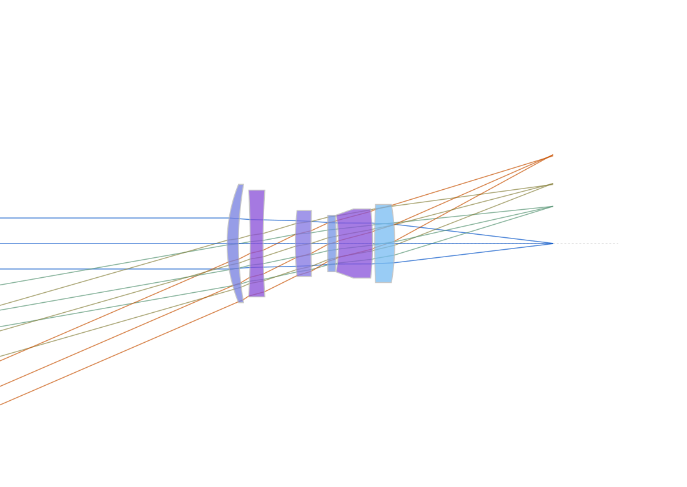

# コーディングエージェント時代の光学設計ツール

## — CLI ベースのステートレス光学設計環境の提案と実装 —

Claude Code や OpenCode を起動して，「50mm F4 のカメラレンズを設計して」と入力するだけ．あとは AI エージェントが YAML を生成し，光線追跡を実行し，最適化を回す．光学設計の専門知識はそのままに，設計プロセスの入り口が自然言語になった．

## 要旨

ソフトウェア開発の領域では，AI コーディングエージェントの急速な普及により，開発環境のあり方が大きく変容しつつある．一方，光学設計の領域では，こうした環境整備が大きく遅れている．本稿では，AI コーディングエージェントから利用しやすい光学設計ツールの条件を考察し，CLI（Command Line Interface）による操作，YAML/JSON による入出力，ステートレスな処理という三つの要件を満たす光学設計ツール「RayWeaver」（https://github.com/onohiroki/RayWeaver）を提案する．RayWeaver は Go 言語で実装された光線追跡エンジンであり，DLS（Damped Least Squares）法による最適化，エスケープ関数による大域的探索，PSF（Point Spread Function）解析などの機能を備える．また，MCP（Model Context Protocol）サーバーを用意し，ツールの説明や入力スキーマなどのメタデータを AI エージェントに提示できるようにした．著者は実作業 3 日で同ツールの中核機能（光線追跡・スポット RMS・最適化）を実装し，AI エージェントとの対話による設計プロセスの変容を確認した．本稿では，その実装例と設計プロセスの変化について報告する．

**キーワード:** 光学設計，AI コーディングエージェント，CLI，YAML，ステートレス，光線追跡，DLS 最適化

---

## 1. はじめに

ここ数年，大規模言語モデル（LLM）に基づく AI コーディングエージェントは，ソフトウェア開発の現場において急速に普及しつつある．Claude Code，Codex，GitHub Copilot，OpenCode などのエージェントは，自然言語による指示からソースコードを生成し，テストを実行し，バージョン管理システムと連携して，ソフトウェアの開発プロセスを大きく変容させている [6–8]．プロフェッショナルなソフトウェアエンジニアであっても，コーディングの相当な部分を AI エージェントに委任できるようになってきている．もちろん，ソフトウェアエンジニアの専門知識が最終的な品質や性能を左右する変数であることに変わりはないが，コーディングという作業そのものは，AI に委任可能な範囲が急速に拡大している．

一方，光学設計の領域では，こうした環境整備の動きがソフトウェア開発に比べて大きく遅れている．その理由は多岐にわたるが，最大の要因は，ソフトウェア開発におけるような，AI エージェントと既存の開発手法が統合された環境が，光学設計には存在しないという点にある．ZEMAX や CODE V などの市販光学設計ツールは，GUI を中心とした操作を前提としており，外部からの制御も GUI アプリを伴う API（ZOS-API 等）や GUI 内マクロに限られていて，標準入出力で完結する自動化インターフェースを提供していない．

本稿では，この問題に対処するためのアプローチとして，AI コーディングエージェントから利用しやすい光学設計ツールの条件を整理し，それを満たす具体的な実装例として「RayWeaver」を紹介する．

RayWeaver: https://github.com/onohiroki/RayWeaver

## 2. 背景：ソフトウェア開発と光学設計の格差

### 2.1 ソフトウェア開発における AI エージェント環境

ソフトウェア開発における AI コーディングエージェントの活用は，CLI による操作，構造化されたデータ形式，テストとバージョン管理などの要素が統合された環境によって支えられている．grep で検索したりコンパイラでコンパイルしたりするように，多くの開発ツールがコマンドラインから呼び出し可能であり，エージェントが直接実行できる．また，YAML，JSON，XML などの構造化データ形式による設定ファイルのやり取りが標準化されており，自動テストフレームワークと Git などのバージョン管理システムが成熟している．

すべてのツールがステートレスなわけでもなく，YAML や JSON の入出力をするわけでもない．しかし，AI エージェントから利用するツールとしては，ステートレス CLI で JSON 入出力が便利であることは確かである．

### 2.2 光学設計ツールの現状

光学設計ツール，特に ZEMAX や CODE V などの市販ソフトウェアは，GUI ベースの操作を前提としており，スクリプティング機能（ZPL，Macro-PLUS など）や外部制御用の API（ZEMAX の ZOS-API など）を提供しているものの，これらは GUI アプリ（とそのライセンス）を伴うものであり，標準入出力で完結する自動化インターフェースとはなっていない．また，これらのツールは独自のファイル形式を使用しており，YAML や JSON のような汎用データ形式とは異なる．

このため，光学設計の領域では，AI エージェントを活用するための環境整備が進んでおらず，ソフトウェア開発に比べて大きな格差が生じている．

## 3. AI フレンドリーな光学設計ツールの条件

ソフトウェア開発における AI コーディングエージェント環境を光学設計にそのまま適用することを考えると，以下の三つの要件を満たすツールが求められる：

1. **CLI による操作:** ツールはコマンドラインから呼び出し可能であり，エージェントが直接実行できること．
2. **YAML/JSON による入出力:** 入力データと出力結果が YAML または JSON で表現され，エージェントが容易に解析・生成できること．
3. **ステートレスな処理:** ツールは状態を保持せず，各呼び出しが独立していること．処理の状態はツールのプロセス内に置かず，標準入出力で受け渡すドキュメントに置く（ドキュメントを状態とする）．これにより，ある呼び出しの出力がそのまま次の呼び出しの入力として再利用でき，結果を失わずに逐次処理を連結できる．コンテキストの管理は AI エージェントが担い，ステートレスな LLM とステートレスな光学設計 CLI ツールを逐次呼び出して制御する．

これらの要件を満たすツールであれば，Claude Code，Codex，GitHub Copilot，OpenCode などの既存の AI コーディングエージェントから容易に制御できるはずである．MCP はこの三要件に代わるものではなく，ツールの説明や入力スキーマなどをエージェントに機械可読な形で伝えるための補完的な接続方式である．特に GUI を中心とするツールでは，エージェントとの標準化された接続手段として MCP の意義が大きい．一方，ステートレス CLI は標準入出力と構造化データだけで直接利用できるため，MCP は必須ではない．ただし，CLI の入出力を MCP のツール呼び出しに対応づけることで，既存機能を保ったまま導入でき，エージェント側での発見や利用を容易にできる．

## 4. RayWeaver：実装例

### 4.1 概要

RayWeaver は，上記の三つの要件を満たす光学設計ツールであり，Go 言語 [4] で実装された CLI 光線追跡エンジンである．YAML 形式の入力ファイルを受け取り，計算結果を YAML 形式で出力する [5]．ツールはステートレスであり，各サブコマンドは独立して実行される．

### 4.2 主な機能

RayWeaver は以下の機能を備える：

- **光線追跡:** 球面および非球面表面を通る逐次光線追跡
- **Chief 線解析:** 六角形/極座標/方形の瞳孔グリッドを用いた Chief 線（スポット重心）の決定
- **Paraxial 解析:** EFL，主点，F 値，入射/出射瞳孔などの一次光学特性
- **DLS 最適化:** 曲面の曲率，厚さ，ガラス分散などの変数に対する Damped Least Squares 法による局所最適化
- **エスケープ関数最適化:** Ishiki-Ono のエスケープ関数 [1] により，複数の局所的最小値を発見する大域的探索
- **PSF 解析:** 直接ベクトル Huygens 積分による点拡がり関数（FFT 不使用）
- **薄膜コーティング解析:** 伝達行列法による反射率，透過率，位相の計算
- **SVG/PNG 図面生成:** 光線追跡図の描画

### 4.3 パイプライン処理

RayWeaver の各サブコマンドは，YAML を標準入力から読み取り，YAML を標準出力に書き出す．これにより，Unix パイプラインの考え方 [9] に基づく，柔軟な処理の組み合わせが可能である．例えば，以下のパイプラインは，Chief 線解析，Paraxial 解析，光線追跡，図面生成を順次実行する：

```sh
./rayweave chief < input.yaml | ./rayweave paraxial | ./rayweave trace | ./rayweave plot -o diagram.svg
```

### 4.4 実装の規模と推移

ここでいう**初版**とは，光学設計に最低限必要な**光線追跡，スポット RMS の計算，最適化（DLS）**の三要素がそろった時点を指す．git のコミット履歴によれば，三要素は次の順に導入された（括弧内はコミット日）．

- 起点：`4860389`（2026-07-20，README のみ）
- 光線追跡：`3e3ea72`（2026-07-21）
- スポット RMS・chief／paraxial：`6294ba3`（2026-07-21）
- DLS 最適化：`73df4bf`（2026-07-24）

コミットが記録された日は 07-20・07-21・07-24 の 3 日であり（07-22・23 はコミットなし），**実作業日にして約 3 日**で三要素がそろった．この時点で Go コードは 32 ファイル・約 6,400 行である．これは，AI コーディングエージェントの支援により，光学設計の中核機能を短期間で実装可能であることを示す．

その後も開発は継続し，本稿執筆時点では Go コード約 94,000 行，`internal/` のパッケージ 26 個，実行ファイル 3 種（`rayweave`，`rwrun`，`importsweep`），サブコマンド 19 種，テスト関数 913 個（111 ファイル），コミット 580 件に達している．

### 4.5 ZEMAX / CODE V との比較

本節では，第 3 章で整理した三つの要件について，市販光学設計ツールの代表である ZEMAX OpticStudio および CODE V と比較し，RayWeaver が AI コーディングエージェントから利用しやすい環境であることを示す．比較結果を表 1 に示す．

**表 1：AI エージェントからの利用しやすさに関する比較**

| 観点 | RayWeaver | ZEMAX OpticStudio | CODE V |
|---|---|---|---|
| **起動方法** | ステートレスな CLI（標準入出力で完結） | GUI 主体．外部制御は ZOS-API（COM/.NET，GUI アプリを伴う）や ZPL マクロ | GUI 主体．バッチ／コマンドライン実行はあるが，公式マニュアルでの案内は限定的 |
| **入力形式** | YAML（汎用テキスト形式）を標準入力から読込 | 独自形式（テキストの .zmx，バイナリの .zar 等） | 独自形式（テキストの SEQ，バイナリの LEN） |
| **出力形式** | YAML を標準出力に構造化して出力 | レポート生成，または限定的なテキスト出力 | レポート生成，または限定的なテキスト出力 |
| **ステートレス性** | 各呼び出しが独立，状態を保持しない | セッション状態（現在のレンズ，最適化履歴）を保持 | セッション状態を保持 |
| **エージェント制御** | ○ 自然言語 → CLI 実行 → YAML 解析のループが成立 | △ ZPL / COM はあるが結果解析が困難 | △ Macro / COM はあるが結果解析が困難 |

表 1 より，ZEMAX や CODE V はスクリプティング機能（ZPL，Macro-PLUS など）や外部制御用の API（ZOS-API など）を提供しているものの，それらは GUI アプリを伴い，入出力は独自形式に依存しており，AI エージェントが結果を自動的に解釈することは困難である．一方，RayWeaver は YAML による入出力とステートレスな CLI という単一の枠組みで統一されており，自然言語による指示から計算結果の解釈までの一連の流れを，エージェントが中断なく実行できる．

### 4.6 MCP によるエージェント連携

RayWeaver は CLI に加えて，MCP サーバーを提供する [12]．MCP サーバーは各機能の説明や引数のスキーマをエージェントに提示し，エージェントはシェルコマンドの構文を組み立てる代わりに，利用可能なツールを把握して構造化された引数で呼び出せる．さらに，ドキュメントやサンプルなどのリソースも同じ接続を通して参照できる．

ただし，RayWeaver の中核的な設計はあくまでステートレス CLI と YAML 入出力である．MCP サーバーは光学計算や YAML の意味論を重複実装せず，呼び出しを CLI に委譲するアダプターとして構成している．このため MCP は CLI の利点を成立させる必須条件ではないが，既存の CLI 機能を活かして比較的小さな追加で導入でき，ツールの発見可能性や引数の伝達を改善する有効な選択肢となる．

## 5. AI エージェントによる設計プロセスの変容

### 5.1 自然言語による設計指示

本節では，設計条件の提示から初期データの調整，最適化，性能評価までを行った実行例を示す．設計条件は「35 mm判フルサイズ（36×24 mm）用，焦点距離50 mm，F4，ダブルガウス型の配置を参考にした6枚の空気間隔構成」とし，画面中心から対角端までを0°，10°，16°，23.4°の4視野，F・d・C線の3波長で評価する．23.4°は，焦点距離50 mmでフルサイズ撮像面の半対角約21.6 mmに対応する視野角である．焦点距離を50±0.5 mm，入射瞳径を12.5 mm（F4相当）に保ち，スポットRMSを小さくする一方，周辺視野の光線が失われることも評価する条件とした．

本例のF4処方自体はゼロから生成したものではなく，既存の `samples/6elements-init.yaml` を出発点として，エージェントが要求に合わせて視野端と絞り径を設定した．ただし，この元となるF2.8の6枚構成のレンズデータ部分は，さらに以前の開発過程で，既存のレンズ処方を種として与えずにAIエージェントが生成したものである．エージェントは曲率スケールを探索してEFL約50 mmとなる初期構成を作り，その後DLS最適化に渡した．一方，最適化条件，メリット関数，制約，複数視野・波長など，現在のサンプルに含まれる周辺設定は，後の人間のユーザーとAIエージェントとの対話を通じて段階的に追加された．したがって，本例は「AIが無から完成した設計ファイル全体を一度に作った」ことを示すものではないが，レンズデータの初期生成と，設定の対話的な発展，その構成を再利用した今回のF4最適化という開発経緯を持つ．元処方はダブルガウス型を参考にした空気間隔構成で，6枚すべてが単レンズであり，古典的な6枚ダブルガウス構成に見られる接合ダブレットを含まない．また，初期処方は概ね対称な配置だが，各面の最適化変数は独立しているため，最適化後の対称性は拘束していない．13個の有効径変数は最適化対象から外し，面形状・厚さ・モデルガラスを最適化対象とした．また，スポットだけを改善するために周辺光線を捨てることを防ぐ目的で，各視野・各メリットモードに `field_alive`（target = 1，weight = 10000）と `pupil_fill`（weight = 1000）を加えた．

最適化と評価はCLIを直接呼び出して実行した（MCPは使用していない）：

```sh
./rayweave optimize --log opt.jsonl < samples/paper-50mm-f4-demo.yaml > optimized.yaml
./rayweave vignette --iterations 3 --min-glass-path 0.5 \
  < optimized.yaml > vignetted.yaml
./rayweave paraxial < vignetted.yaml
./rayweave chief --wl 0.0004861 < vignetted.yaml > chief-F.yaml
./rayweave chief --wl 0.0005876 < vignetted.yaml > chief-d.yaml
./rayweave chief --wl 0.0006563 < vignetted.yaml > chief-C.yaml
./rayweave query --each 'chief_rays[]:field_angle,spot_stats.rms_r' \
  < chief-d.yaml
./rayweave trace < vignetted.yaml \
  | ./rayweave chief --marginal-rays \
  | ./rayweave trace \
  | ./rayweave plot -o docs/ai-agent-optical-design-50mm-f4-raytrace.svg
```

実行環境は RayWeaver commit `b2bbdb7`（ビルドメタデータ上のバージョンは `dev`），Go 1.27.3，macOS/arm64である．DLSは256本，最終評価は同じ六角形瞳グリッドの512本で行った．`optimize` は最大500反復で終了し，メリット値は \(2.339\times10^5\) から \(2.027\times10^2\) に減少したが，終了状態は `max_iterations` であり，収束判定には至らなかった．最適化後に `vignette` で有効径を再設定し，スポットを評価した．表2に，d線の最適化前後のRMSと，最適化後の3波長におけるRMSを示す．RMSは生き残った光線に対して計算されるため，併記した有効光線割合（瞳グリッド光線の生存率）と合わせて読む必要がある．

**表2：6枚構成50 mm F4例の視野別スポットRMSと有効光線割合**

| 視野 | 最適化前 d線 RMS (µm) | 最適化後 F線 RMS (µm) | d線 RMS (µm) | C線 RMS (µm) | 最適化後 d線 有効光線割合 |
|---:|---:|---:|---:|---:|---:|
| 0° | 444.4 | 31.4 | 29.6 | 33.2 | 1.000 |
| 10° | 652.8 | 12.1 | 11.1 | 12.6 | 0.820 |
| 16° | 981.0 | 62.8 | 89.5 | 44.8 | 1.000 |
| 23.4° | 460.2 | 169.0 | 158.0 | 158.9 | 0.861 |

最適化後の一次量は，EFL = 50.41 mm，入射瞳径 = 12.50 mm，F値 = 4.03，全長 = 76.42 mmであり，指定した焦点距離とF値に近い値を得た．最適化前後でd線のスポットRMSは各視野で小さくなったが，初期状態の対角端では有効光線割合が0.137にすぎず，初期RMSは瞳の一部だけから算出されている．最適化後も10°および23.4°で有効光線割合はそれぞれ0.820，0.861であり，完全な瞳充足ではない．また，対角端のRMSは約158 µmで，中心付近の値より大きい．したがって，本例は要求に近い一次量を持つ設計データを生成して評価するワークフローの実例であり，実用レンズとしての性能達成を示すものではない．使用ガラスも実在カタログガラスに置換しておらず，公差・回折MTF・製造可能性の評価は含まない．



**図1：** 最適化および口径調整後の光学系断面とd線の主光線・周辺光線．光線の色は視野角を表す．

### 5.2 ツールと設計データの共進化

さらに，自然言語による指示により，CLI ツール自体の改善と設計データの改善を同時に進めることができる．AI エージェントに，ツールのコードの問題点や機能追加の提案をさせ，実行し，効果を確かめることを繰り返すことで，光学設計 CLI ツールが徐々に改善されていく．同時に，設計データもそれに伴って改善される．

### 5.3 公開と再利用

著者は，RayWeaver のソースコードを GitHub で公開した．これにより，他の利用者は，リポジトリを自分のコンピュータにクローンし，AI エージェントに指示するだけで，実行ファイルをビルドし，光学設計を開始できる．CLI ツールのコードに問題があれば，AI エージェントに指示して修正や機能追加を行うことができ，設計データはそれを反映して改善されていく．

## 6. 考察

### 6.1 AI パワーと専門知識の関係

ここで重要なのは，AI コーディングエージェントが光学設計の専門知識を必要としなくなるわけではないという点である．光学や光学設計 [10, 11]，設計ツールのアルゴリズムなどを知っていれば，ツールの使い方を知らなくても，AI エージェントがそれを理解し，適切な指示を生成できる．つまり，光学設計のやり方が変わるだけであり，専門知識の重要性は変わらない．

### 6.2 今後の展望

現在は，AI コーディングエージェントをそのまま利用するのが最良の選択肢である．将来的には，エージェント側に光学設計専用の機能が追加され，統合されることで，より扱いやすくなる可能性がある．しかし，市販の光学設計ツールが AI レディになるのを待つよりも，自分でツールを作って始めた方が，はやく実用的な環境を構築できるかもしれない．また，中間結果の直列化に MessagePack などのバイナリ表現を選べば，よりコンパクトで高速な受け渡しができ，シリアライザに依存しない厳密性を確保できる（ただし人間可読性は失われる．第 6.3 節）．

ソフトウェア開発において，エンジニアが自然言語でAIに指示してソフトウェア開発が進められるようになったように，光学設計も光学エンジニアが自然言語で指示をするだけで設計がすすむようになるだろう．

### 6.3 限界と課題

本アプローチには，次のような限界がある．

**ステートレス性の代償とその緩和．** ツールは状態を保持しないため，最適化の履歴管理，収束判定，中断からの再開は，すべて AI エージェント（コンテキスト）側の責務となる．また最適化は長時間に及び，エージェントのセッションが切断されると，そのツールが起動した長時間ジョブまで失われうる．前者については，各サブコマンドが入力ドキュメントを保持したまま結果を追記して標準出力へ書き出すため，その出力がそのまま次のサブコマンドの入力として再利用でき，パイプで連結できる．すなわち，状態をプロセスではなくドキュメントに置くことで，ステートレス性の不利は大きく緩和される．長時間ジョブについては，独立セッションで起動する補助ツール `rwrun` と，SIGTERM による二段階の安全な停止機構によって緩和している．

**直列化形式．** YAML はテキスト形式であるため，一般には直列化の際に倍精度浮動小数点が丸められる懸念がある．しかし，丸めが生じるか否かはシリアライザの桁数指定に依存し，桁数を十分確保して最短往復表現を出力すれば float64 は厳密に往復する．本実装が用いる `gopkg.in/yaml.v3` は `strconv.FormatFloat(f, 'g', -1, 64)` により最短往復表現で出力するため，入出力を通じて値は丸められない．一方，MessagePack のようなバイナリ表現は，IEEE 754 表現をそのまま格納するためシリアライザに依存せず厳密性を保証でき，よりコンパクトで高速であるが，人間可読性とエージェントによる直接解釈のしやすさを失う．本稿では可読性と汎用性を優先して YAML を採用している．

**出力ドキュメントの増大．** 各サブコマンドは結果を入力ドキュメントに追記して出力するため，系が大きい場合や結果が膨大な場合にドキュメントが肥大化する．不要な結果は `clean` サブコマンドで除去できる．

**残る専門知識．** 自然言語で指示できるとはいえ，初期構造の選択，最適化変数の選定，メリット関数の重み設計，得られた設計の妥当性判断は，依然として設計者の光学の専門知識に依存する（第 6.1 節）．

**対象範囲の限定．** 現時点では公差解析や照明解析などは未実装であり，市販ツールが機能的に優る領域が残る．本稿の主張は「すべての機能で市販ツールを代替する」ことではなく，「AI エージェントから利用しやすい入口を提供する」ことにある．

## 7. おわりに

本稿では，AI コーディングエージェント時代の光学設計ツールのあり方を考察し，CLI ベースのステートレス光学設計環境「RayWeaver」を提案した．RayWeaver は，CLI による操作，YAML/JSON による入出力，ステートレスな処理という三つの要件を満たし，既存の AI コーディングエージェントから容易に制御できる．さらに，MCP サーバーを CLI のアダプターとして用意し，ツールの説明や入力スキーマなどのメタデータをエージェントに提示する仕組みを加えた．MCP はステートレス CLI に必須ではないが，既存の入出力契約を活かして比較的小さな追加で導入でき，エージェントとの連携をより明確にする．著者は実作業 3 日で同ツールの中核機能を実装し，AI エージェントとの対話による設計プロセスの変容を確認した．光学設計の領域における AI エージェントの活用は，ソフトウェア開発に比べて遅れているが，適切なツールを自分で構築することで，この格差を埋めることができる．

---

## 参考文献

1. Ishiki, T., & Ono, H. (2020). Escape function optimization for lens design. *Optics Express*, 28(12), 17890–17901.
2. ZEMAX OpticStudio. Zemax, LLC.
3. CODE V. Synopsys, Inc.
4. Go Programming Language. https://go.dev/
5. YAML Specification. https://yaml.org/
6. Vaswani, A., et al. (2017). Attention is all you need. *Advances in Neural Information Processing Systems*, 30.
7. Chen, M., et al. (2021). Evaluating large language models trained on code. *arXiv:2107.03374*.
8. Jimenez, C. E., et al. (2024). SWE-bench: Can language models resolve real-world GitHub issues? *International Conference on Learning Representations (ICLR)*.
9. Raymond, E. S. (2003). *The Art of Unix Programming*. Addison-Wesley.
10. Gross, H., et al. (2005). *Handbook of Optical Systems, Vol. 1: Fundamental Optics*. Wiley-VCH.
11. Kingslake, R., & Johnson, R. B. (2010). *Lens Design Fundamentals* (2nd ed.). Academic Press.
12. Model Context Protocol. https://modelcontextprotocol.io/
